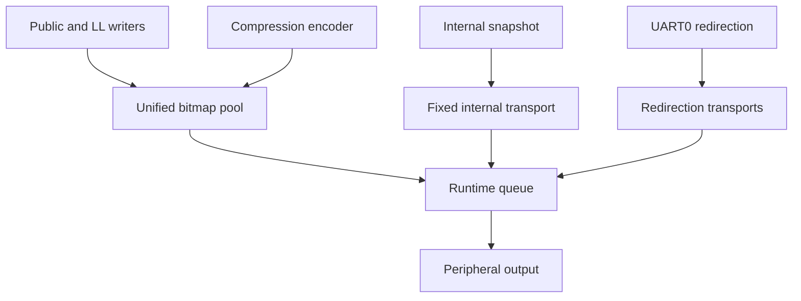

# BLE Log

BLE Log is an asynchronous binary logging transport for Bluetooth controller,
Host HCI, application, and compressed logs.

## Architecture



The shared pool contains `CONFIG_BLE_LOG_POOL_TRANS_CNT` transports. The last
`CONFIG_BLE_LOG_POOL_NON_YIELD_RESERVE_CNT` transports are reserved for ISR and
other contexts that cannot yield. Ordinary yieldable task writers, from the
public API and claims to the controller LL task, wait for a shared transport
unless a claim explicitly opts out. Writers on the shared ESP Timer task never
wait for a transport: its callbacks must return so dispatch can progress.
While yieldable, they use shared transports only; ISR and critical-section
writers retain reserve access and fail-fast behavior.

The Internal Snapshot and UART0 redirection transports are not members of the
bitmap pool.

Periodic flushing scans the whole bounded pool, not just OPEN bitmap hints:
writers temporarily remove their hints while writing or holding a claim. A
failed try-lock leaves `pending_seal`; the next claim seals the old buffer
before appending, or a later periodic scan seals it when unlocked. This is a
deferred request, not a snapshot barrier. Seal and recycle clear the flag,
but a delayed flusher can set it afterwards; an extra early partial seal is
allowed. Full flush/deinit retain OPEN-only scans after writers drain.

FREE acquisition requires the lock, FREE state, and atomically removing an
actually published FREE bit. A cached candidate alone cannot bypass the
recycler's state-to-bitmap publication window. UART0 periodic flushing is
independent of producer enable: disable stops new writes, not cached output.

## Runtime dispatch

Sealed transports enter one bounded queue, drained by one of two dispatch
paths:

- Non-USB backends (SPI, UART, test) use a one-shot ESP Timer deferral. The
  first submission anchors the deadline at 1 ms; later submissions do not move
  it. Each callback drains the queue depth captured at entry and schedules
  another fixed defer only for arrivals left behind, so it does not
  continuously monopolize the shared ESP Timer task.
- Copy-FIFO builds (TinyUSB CDC and USB Serial/JTAG) drain the queue from a
  dedicated task that blocks on it: the 1 ms defer cadence caps throughput
  well below the USB bulk endpoint (see `CONFIG_BLE_LOG_PRPH_COPY_FIFO`).
  Deinit stops that task through the gate it
  already owns: it closes `rt_inited` and posts a NULL stop token, which that
  one receive reads as "stop"; the queue reserves a slot for the token, so the
  post never waits for room. The task then recycles what the closed gate left
  queued and acknowledges the stop. A token rather than a task-abort poke,
  because the task can be blocked inside its dispatch call, where cancelling
  the wait would also cancel one of TinyUSB's own mutex takes. Only after that
  ack *and* the task's own suspend is the task deleted, so teardown can never
  abort a dispatch call in flight. The suspend is waited
  for as well because the ack arrives earlier: between the two, deleting the
  handle would hand a still-running task to the kernel's terminated-task
  cleanup, which then never frees its TCB and stack. Both waits share one
  bounded budget; exceeding it logs an error and trips the teardown
  assertion.

## Version 8 frame

All multi-byte fields use the target's little-endian representation.

```text
offset  size  field
0       2     payload length
2       4     frame_meta
6       N     payload
6 + N   4     checksum
```

`frame_meta` is:

```text
bits 0..7    source
bits 8..31   sequence number, low 24 bits
```

The checksum is `ble_log_fast_checksum()` over the six-byte header and exactly
`payload length` bytes. It excludes the checksum field and peripheral-only DMA
padding.

Core frame payloads follow the writer entry point, not a single rule:

- Public write / claim path (`write_hex`, compressed encoder): the API
  prepends a `[4-byte low32 esp_timer_get_time() microseconds]` before
  the source payload. The timestamp is captured at API entry before any
  pool mutex wait. It wraps approximately every 71.6 minutes and must be
  unwrapped modulo 2^32 by the receiver.
- LL callback path (`write_hex_ll`, covering the LL_TASK / LL_HCI /
  LL_ISR sources): controller payloads are forwarded raw, with no ESP
  timestamp prefix — the on-wire layout is exactly what the controller
  handed over.

UART0 redirection payload is likewise the raw console stream with no
timestamp prefix: the redirection stream keeps its own frame sequence, and
its receiver-side arrival time (aggregation delay bounded by the periodic
redirection flush) is the alignment reference against the core timeline.

### Sources

The public `ble_log_src_t` ABI is frozen and its values are the on-wire
source IDs of protocol v8 frames:

```text
0  INTERNAL
1  CUSTOM
2  LL_TASK
3  LL_HCI
4  LL_ISR
5  HOST
6  HCI
7  ENCODE
8  REDIR extension
```

Core log sources (`CUSTOM` through `ENCODE`) and Internal Snapshots share one
24-bit Global SN. Core logs consume it after entry validation and gate acceptance,
before buffer contention; lost log attempts leave gaps accounted for by
`lost_frame_cnt`. Snapshots consume it only after acquiring their dedicated
transport, when assembling the frame. Busy/skipped snapshots do not consume a
Global SN and are not included in `lost_frame_cnt`.
Snapshots also carry a separate 24-bit `anchor_count` in their payload:
only snapshot attempts advance this counter, including skipped snapshots.
The periodic task-binding broadcast and REDIR console stream retain their
own separate header sequences (gaps count skipped binding windows or dropped
console batches). `ble_log_init()` resets all sequences and the anchor counter,
and its required `INIT` snapshot starts a new
receiver epoch. They remain continuous through `FLUSH` within that epoch.
Callers must not write until `ble_log_init()` returns, so the `INIT`
snapshot is submitted first.

`CONFIG_BLE_LOG_HCI_LOG_ENABLED` controls HCI logging. Bluedroid and legacy
VHCI NimBLE retain Host-side capture and suppress duplicate Controller HCI
records. Other configurations, including non-legacy NimBLE, retain Controller
HCI records through the LL callback (requires `CONFIG_BLE_LOG_LL_ENABLED`).
Controller flags preserve their source mapping: `HCI` to `LL_HCI` and
`HCI_UPSTREAM` to `HCI`, with ISR precedence. Controller payloads are forwarded
unchanged. Host-side capture retains its direction bit in HCI payload byte 0
bit 7. Disabling HCI logging suppresses records from both capture paths.

## Internal Snapshot

All BLE Log-owned internal information is emitted as fixed-layout frames
from dedicated transports: the snapshot frame is 179 logical bytes on its
180-byte aligned transport, and the periodic task-binding broadcast has its own
transport sized to the registry (one full binding frame per window;
`CONFIG_BLE_LOG_TASK_ID_MAX` entries of 19 bytes plus a timestamp).

The snapshot contains:

- reason flags (`INIT`, `PERIODIC`, `FLUSH`, `TS_VALID`);
- a 24-bit little-endian `anchor_count` (three bytes), immediately after the reason flags;
- the complete 58-byte build, library, chip, and protocol version block;
- the LC clock, ESP Timer, and FreeRTOS tick samples captured together with
  the GPIO sync level;
- pool count, reserve count, current inflight count, and inflight peak;
- compact statistics for `CUSTOM` through `ENCODE` (one slot per public
  source in that range, `HOST` included).

The periodic snapshot is an always-on system behavior from initialization
until deinitialization. It cannot be stopped by the TS sync IO control API.
A skipped periodic snapshot advances only the anchor count, not the Global SN.
Anchor counts start at zero for INIT, also advance for FLUSH, and wrap modulo
2^24 on the wire (the atomic runtime counter remains uint32_t).
A gap between anchor counts identifies missed snapshot attempts without
mistaking intervening ordinary logs for missed snapshots.

Each source statistic contains only:

```c
uint32_t written_frame_cnt;
uint32_t lost_frame_cnt;
uint32_t written_bytes_cnt;
```

Successful counts are incremented only after a complete frame is committed to
a transport; they do not imply confirmed physical TX. `written_bytes_cnt`
counts the full logical frame (six-byte header, payload including any timestamp
prefix, and four-byte checksum), excluding peripheral DMA padding. Rejected or
aborted writes do not add bytes; there is no lost-byte counter. Internal and
REDIR frames are not included in these per-core-source byte counters. All three
counters are uint32 values and wrap modulo 2^32.
Core counts and the pool peak restart after a completed FLUSH; the Global SN
and anchor count remain continuous. A busy periodic Internal
transport is never overwritten; that snapshot is skipped and counted. Required
INIT and FLUSH snapshots use a bounded task-context wait.

The protocol version remains v8 despite the changed snapshot payload layout and
header sequence semantics. Receivers must be updated together with the producer;
the version byte alone cannot distinguish the old and new layouts.
The snapshot remains a sampling point,
not a confirmed TX boundary: periodic OPEN flushing is best-effort, statistics
are sampled individually while writers can run, and Global SN allocation order
is not submission order. Neither deferred sealing nor the anchor count makes
snapshot differences an exact SN-interval accounting boundary.

## Public API

```c
bool ble_log_init(void);
void ble_log_deinit(void);
bool ble_log_enable(bool enable);
void ble_log_flush(void);
bool ble_log_write_hex(ble_log_src_t source, const uint8_t *data, size_t len);
uint8_t *ble_log_claim(ble_log_src_t source, size_t maximum,
                       uint32_t *handle, bool wait_for_transport);
void ble_log_commit(uint32_t handle, size_t actual_len);
void ble_log_write_hex_ll(uint32_t len, const uint8_t *data,
                          uint32_t append_len, const uint8_t *append,
                          uint32_t flags);
bool ble_log_ts_sync_io_toggle_enable(bool enable);
bool ble_log_sync_enable(bool enable);  /* compatibility shim */
```

`ble_log_enable()` gates public producers only. Periodic system output remains
active while that gate is closed.

`ble_log_ts_sync_io_toggle_enable()` controls only the optional external
analyzer GPIO, which starts disabled and low. Disabling it leaves the IO low
after a final falling edge;
periodic clock sampling, OPEN transport flushing, and Internal Snapshots
continue. When the GPIO feature is not built, the call remains a
lifecycle-checked no-op. `ble_log_sync_enable()` is the backward-compatible
name for the same behavior.

`ble_log_flush()` is an ordinary FreeRTOS task API. Do not call it from an ISR,
critical section, or the shared ESP Timer task.

A public or LL record that cannot fit completely in one pool transport is
rejected and counted as lost; BLE Log never emits a truncated record.

## Compression direct write

Compression encoders write directly into shared-pool storage:

```c
uint32_t handle;
uint8_t *payload = ble_log_claim(BLE_LOG_SRC_ENCODE, maximum,
                                 &handle, true);
if (payload) {
    size_t encoded = encode(payload, maximum);
    ble_log_commit(handle, encoded);
}
```

`ble_log_claim()` reserves the hidden frame header, ESP Timer timestamp, and
checksum. It waits for a shared transport in ordinary yieldable tasks when
`wait_for_transport` is true (writer backpressure); pass false to opt out.
The shared ESP Timer task and non-yieldable contexts fail fast either way.
A busy-pool rejection leaves a Global SN gap and increments the source's loss
counter, just like other pool acquisition failures.
Every successful claim must be committed exactly once before
`ble_log_deinit()`; `ble_log_commit(handle, 0)` cancels it. Handles include a
transport generation so a stale handle cannot commit a later claim in the same
lifecycle.

Mesh, ISO, Bluedroid, and NimBLE compression no longer allocate three static
payload buffers per channel. Every ENCODE record names its writer: the byte
after the source is a task id from a name-keyed registry. The registry is a
self-contained module (`ble_log_task_registry.c/h`, structured like the
UART redirection writer: a small append-only table shared by every ENCODE
writer; RAM cost 16 bytes per entry, sized by `CONFIG_BLE_LOG_TASK_ID_MAX`).

The registry broadcast is module-owned system output: every periodic snapshot
window, one INTERNAL frame (`BLE_LOG_INT_SRC_TASK_BINDING`) packs one
fixed-layout record per registered entry, binding each id to its task name.
It rides the registry's own dedicated transport with a sequence of its own
(a window skipped despite a non-empty registry leaves a gap in the binding
sequence, never in the Global SN or snapshot anchor count), is never counted in the
per-source written/lost stats, and never contends with the snapshot
transport or with user records for pool transports. A receiver that joined
late or lost a frame converges on the next window; a record of a new task
keeps its id and is bound by name at the next window. Announcements are
idempotent on the wire and best effort (a busy binding transport — the
previous broadcast still in DMA — skips a window).
Attribution is a property of the record, so concurrent writers to one source
need no serialization and never drop a record on contention. When the registry
is full, a new task degrades to the unknown id (`0xFF`) and its records are
still emitted.

## Configuration

| Option | Default | Meaning |
| --- | ---: | --- |
| `CONFIG_BLE_LOG_ENABLED` | n | Enable BLE Log |
| `CONFIG_BLE_LOG_POOL_TRANS_CNT` | 8 | Unified pool transport count, range 2..32 |
| `CONFIG_BLE_LOG_POOL_NON_YIELD_RESERVE_CNT` | 1 | ISR/critical reserve count |
| `CONFIG_BLE_LOG_POOL_TRANS_SIZE` | 640 | Bytes per shared transport; SPI builds require a multiple of four |
| `CONFIG_BLE_LOG_LL_ENABLED` | target dependent | Controller LL logging |
| `CONFIG_BLE_LOG_HCI_LOG_ENABLED` | y | HCI capture from Host or Controller, selected by transport |
| `CONFIG_BLE_LOG_TASK_ID_MAX` | 16 | Task-id registry size, range 2..32; 16 bytes of RAM per entry |
| `CONFIG_BLE_LOG_TS_SYNC_TOGGLE_IO_ENABLED` | n | Build the optional analyzer GPIO toggle |
| `CONFIG_BLE_LOG_TS_ENABLED` | n | Deprecated compatibility entry selecting the GPIO toggle |
| `CONFIG_BLE_LOG_PRPH_USB` | n | Use the USB OTG device as transport (see below) |
| `CONFIG_BLE_LOG_PRPH_USB_SERIAL_JTAG` | n | Use USB Serial/JTAG as transport (see USB Serial/JTAG transport) |
| `CONFIG_BLE_LOG_USB_CDC_TX_BUFSIZE` | 2048 | CDC TX FIFO size; must equal `CONFIG_TINYUSB_CDC_TX_BUFSIZE` |
| `CONFIG_BLE_LOG_USB_CDC_EP_BUFSIZE` | 512 | CDC endpoint packet buffer. Keep 512 (the High-Speed bulk MPS) on High-Speed; on Full-Speed raise it to 1024, where the 64-byte MPS costs roughly half the achievable rate (see Buffer sizing) |
| `CONFIG_BLE_LOG_USJ_TX_BUFSIZE` | 2048 | USB Serial/JTAG driver TX ring; must be >= `CONFIG_BLE_LOG_POOL_TRANS_SIZE` |

Old multi-LBM sizing options remain hidden only so existing sdkconfig files can
be parsed; they no longer control allocation.

## USB transport

The USB transport copies each sealed transport into the TinyUSB CDC-ACM TX
FIFO and recycles it immediately; a FIFO that cannot hold a whole transport
drops it and prints a warning once per periodic window (transport and byte
counts, separate from pool loss). It works on any target with a USB OTG
peripheral, Full-Speed or High-Speed.

BLE Log is a component inside the IDF tree, so it cannot declare the managed
dependency itself. Copy the template manifest `idf_component_usb.template.yml`
from the BLE Log component directory into the application's `main/`
(merge it into an existing `idf_component.yml` if one is present), otherwise
enabling `CONFIG_BLE_LOG_PRPH_USB` fails the CMake configure with a fatal
error. Its content is simply:

```yaml
dependencies:
  espressif/esp_tinyusb: "^2.0.0"
```

Run `idf.py reconfigure` once after copying or editing the file so the
component manager fetches the component; `CONFIG_TINYUSB_CDC_ENABLED` must
then be set. Finally, keep the TinyUSB CDC buffer options equal to their
BLE Log counterparts: `CONFIG_TINYUSB_CDC_TX_BUFSIZE ==
CONFIG_BLE_LOG_USB_CDC_TX_BUFSIZE` and `CONFIG_TINYUSB_CDC_EP_BUFSIZE ==
CONFIG_BLE_LOG_USB_CDC_EP_BUFSIZE`; `CONFIG_TINYUSB_CDC_RX_BUFSIZE` at
least the endpoint size; mismatches are fatal build errors. The device
enumerates as VID 0x303A PID 0x10B1, product/interface string
`BLE-Log-Port (<target>)` (the base name is a literal prefix; the target
is the `IDF_TARGET` the image was built for), distinct from the TinyUSB/blbm
bridge `0x4001`.

### Buffer sizing

These three buffers are the transport path's whole absorption budget, and
they cost `TX_BUFSIZE + RX_BUFSIZE + 2 * EP_BUFSIZE` bytes of static RAM
(TinyUSB keeps one IN and one OUT endpoint buffer, both sized by
`EP_BUFSIZE`). The defaults - `TX 2048`, `RX 512`, `EP 512` - come to 3584
bytes. Measured with a producer that is faster than the link (perf mode,
5 s steady-state windows, ESP-IDF v6.2):

| Setting | High-Speed (ESP32-S31) | Full-Speed (ESP32-S3) |
| --- | --- | --- |
| `EP_BUFSIZE=64` | - | 0.58 MiB/s |
| `EP_BUFSIZE=256` | - | 0.88 MiB/s |
| `EP_BUFSIZE=512` | **7.5 MiB/s** | 0.97 MiB/s |
| `EP_BUFSIZE=1024` | 6.8 MiB/s | 1.03 MiB/s |
| `EP_BUFSIZE=2048` | 6.9 MiB/s | 1.05 MiB/s |
| `TX_BUFSIZE=1024`, `EP=512` | 7.1 MiB/s | - |
| `TX_BUFSIZE=4096`, `EP=512` | 7.5 MiB/s | - |

`EP_BUFSIZE` is the length of one bulk IN submission, while the packet size
in the device descriptor is fixed at 512 (High-Speed) or 64 (Full-Speed). On
High-Speed that makes 512 the sweet spot - one submission is exactly one
packet - and larger values lose about 9% for 1.5-4.5 KB more RAM. On
Full-Speed one 64-byte packet per submission is far too slow, so raise
`EP_BUFSIZE` to 1024; 2048 adds 2% for 3 KB. `RX_BUFSIZE` has no measured
effect on throughput; keep it at its `EP_BUFSIZE` minimum. `TX_BUFSIZE` buys
little below 2048 and nothing above it.

## USB Serial/JTAG transport

On a chip with only USB Serial/JTAG (C3, C5, C6, C61, H2, H21), or when you
want the USJ jack instead of the USB OTG jack (H4, S3), BLE Log can copy each
sealed transport into the USB-Serial-JTAG driver TX ring. The hardware FIFO
is 64 bytes and is not configurable. The device stays the ROM USB
Serial/JTAG identity (VID 0x303A PID 0x1001). The host opens that CDC-ACM
port. It does not match PID 0x10B1 or the product string `BLE-Log-Port`.

### First write waits for the host port open

The signal is the `SET_LINE_CODE` / `DTR_CHG` / `RTS_CHG` bits of
`USB_SERIAL_JTAG.int_raw`. The host sets them when it programs the port, and a
chip reset clears them. A transport produced before that first open
is dropped through the not-connected path, so it does not raise the
FIFO-full counter.

The latch proves the port was opened at least once since the chip reset,
not that it is open now. Re-enumeration without a chip reset (unplug and
replug, host reboot) leaves the latch set, so a commit can still land in the
new enumeration window. Not reproduced on hardware.

A second failure mode is independent of the gate.
`EP1_CONF.SERIAL_IN_EP_DATA_FREE` can read 0 from boot and never recover. The
driver ring then accepts transports that no interrupt drains, and the port
stays silent until the chip is reset. Observed in 1 of 8 boots.

ESP32-C3 and ESP32-S3 do not have those three interrupt bits. On those two
targets the transport writes as soon as the SOF-based
`usb_serial_jtag_is_connected()` reports connected, which is the behaviour
from before the gate.

On C6 the BLE Log peripheral default stays UART DMA (`SOC_UHCI_SUPPORTED`).
USJ is opt-in. On H4, OTG TinyUSB and USJ are two choice members because
they are two ports with two host identities.

### Console and other FIFO owners

The 64-byte USJ FIFO has one software owner. BLE Log will not steal it.

A default sdkconfig on a USJ chip turns on
`CONFIG_ESP_CONSOLE_SECONDARY_USB_SERIAL_JTAG`, which sets
`CONFIG_ESP_CONSOLE_USB_SERIAL_JTAG_ENABLED`. That secondary console already
owns the FIFO. Hidden `CONFIG_BLE_LOG_USJ_BUS_BUSY` is then y, and the BLE
Log USJ choice is not in the menu. The same hide applies when
`CONFIG_ESP_TRACE_TRANSPORT_USB_SERIAL_JTAG` or
`CONFIG_OPENTHREAD_RCP_USB_SERIAL_JTAG` is on, or when
`CONFIG_USJ_ENABLE_USB_SERIAL_JTAG` is off.

The hide is one-way. BLE Log does not `select` the console off. A reverse
`depends` from the console onto BLE Log caused a Kconfig loop, so the
operator has to release the port:

1. Console: primary `ESP_CONSOLE_UART_DEFAULT` (or `ESP_CONSOLE_NONE`),
   secondary `ESP_CONSOLE_SECONDARY_NONE`. Keep UART as the console if you
   still want `ESP_LOG` / REPL; `idf.py monitor` then uses the UART-bridge
   COM port, not the USJ ACM node.
2. esp_trace: transport not "USB Serial JTAG".
3. OpenThread RCP: transport not "USB RCP".
4. Leave `CONFIG_USJ_ENABLE_USB_SERIAL_JTAG` on.
5. `Component config -> Bluetooth -> Common Options -> Enable BT Log Async
   Output` -> peripheral `Utilize USB Serial/JTAG as transport`.
6. Leave `CONFIG_BLE_LOG_USJ_TX_BUFSIZE` at 2048 unless
   `CONFIG_BLE_LOG_POOL_TRANS_SIZE` is larger than 2048.
7. No `esp_tinyusb` manifest entry. That requirement belongs only to
   `CONFIG_BLE_LOG_PRPH_USB`.

If another caller already ran `usb_serial_jtag_driver_install`,
`ble_log_init` returns false. That is a failed install, not a stolen
console. `BLE_LOG_PRPH_USB_SERIAL_JTAG` depends on `!BLE_LOG_USJ_BUS_BUSY`,
so menuconfig cannot enable both. If `sdkconfig.defaults` sets the USJ
transport while the console still owns the FIFO, Kconfig turns the
choice off. CMake still `FATAL_ERROR`s if both symbols are y. That only
happens from a hand-edited sdkconfig that bypasses Kconfig.

### ROM dual-write on C3 and S3

`SECONDARY_NONE` is necessary but not sufficient on C3 and S3.

Those ROMs define `ESP_ROM_CONSOLE_OUTPUT_SECONDARY`: `uart_tx_one_char`
also writes each console byte to USJ. `cpu_start` then calls
`esp_rom_install_uart_printf()`, which forces ROM `g_usb_print` back to
true (the `ESP_ROM_HAS_ETS_PRINTF_BUG` workaround so IDF `esp_rom_printf`
still works after an eFuse/RTC ROM-log disable). Channel 2 of
`ets_printf` is the ROM secondary USB putc and stays installed when the
primary console is UART.

The result: UART console characters still appear on the same CDC-ACM node
as BLE Log, and they corrupt binary frames.

A successful `ble_log_prph_init` therefore:

- sets `g_usb_print = false` on `ESP_ROM_HAS_ETS_PRINTF_BUG` chips (C3, S3);
- calls `esp_rom_install_channel_putc(2, NULL)` on every USJ target.

`g_uart_print` is left true, so the UART console still prints. The mute is
not restored on deinit: restoring it would resume stuffing the FIFO after
the driver is gone. ROM paths that ignore `g_usb_print` (rare direct
`usb_serial_device_tx_one_char` calls) cannot be silenced from IDF.

C5, C6, and later USJ chips do not have that `g_usb_print` leak. Channel 2
is still uninstalled so `ets_printf` cannot use a leftover USB putc.

### Teardown

`ble_log_deinit` seals leftover transports and copies each one into the
USJ TX ring, or drops it if the ring cannot hold it. It then uninstalls
the driver. Bytes still in the ring are discarded. There is no
`usb_serial_jtag_wait_tx_done` call. An unbounded wait can hang when SOF
packets continue but the host is not reading the ACM port.

TinyUSB CDC uses the same COPY_FIFO contract. UART DMA waits for hardware
TX because that wait does not depend on a host reader.

### Light sleep

`CONFIG_USJ_NO_AUTO_LS_ON_CONNECTION` depends on
`ESP_CONSOLE_USB_SERIAL_JTAG_ENABLED`. BLE Log USJ keeps the console on
UART, so that option is hidden. BLE Log does not take an
`ESP_PM_NO_LIGHT_SLEEP` lock. If the application enables automatic light
sleep (`PM_ENABLE`), USJ output stops while the chip sleeps. Do not
combine BLE Log USJ with automatic light sleep. Take that lock in the
application if USJ must stay up during automatic light sleep.

### Which USB connector

The host identity is ROM USJ: `lsusb` shows `303a:1001` and Linux creates
`/dev/ttyACM*`. Open that ACM node. Do not open the JTAG interface.

`10c4:ea60` (CP210x) or `1a86:7523` (CH340) is a USB-UART bridge on UART0,
not USJ. BLE Log USJ cannot use that port. Official ESP32-C3-DevKitM-1 /
DevKitC-02 Type-C is USJ (GPIO18 D-, GPIO19 D+). UART0 is on the header
pins. Third-party C3 boards often wire the only USB connector to a UART
bridge and leave GPIO18/19 unconnected.

### Resource occupancy (ESP32-C5 @ 240 MHz)

Measured on `ble_log_usj_test` with `idf.py size-files` / `--archives`
against `ble_log_usj_test.map`. Flash and static SRAM are link-map bytes.
Heap rows are the buffers this path allocates at `ble_log_init`, not
map `.bss`.

| Item | Flash | Static SRAM | Heap at init | Notes |
| --- | --- | --- | --- | --- |
| `ble_log_prph_usb_serial_jtag.c` | 614 B | 9 B | 0 | USJ peripheral only. |
| `libesp_driver_usb_serial_jtag.a` | 1949 B | 111 B | TX 2048 B + RX 128 B, plus the driver object, TX stash (64 B), mutex, idle semaphore, and USJ ISR | Pulled in because console is UART; BLE Log is the driver owner. |
| USJ-specific subtotal | 2563 B | 120 B | ~2.2 KB rings, plus driver object / synch / ISR | Incremental cost of choosing USJ vs a dummy peripheral that does not link the driver. |
| BLE Log COPY_FIFO (shared with TinyUSB CDC) | (in `ble_log_rt.c` / `ble_log_lbm_v2.c`) | | Dispatch task stack 1024 B (RISC-V; 2048 B on Xtensa); pool 8 x 640 B = 5120 B plus transport structs and the runtime queue | Same COPY_FIFO path as `CONFIG_BLE_LOG_PRPH_USB`. Not USJ-only. |

CPU: 6.3% of one core (FreeRTOS IDLE delta) while the USJ driver was
written at its drop-rate load on C5 @ 240 MHz. That measurement called
`usb_serial_jtag_write_bytes` directly (`timeout` 0, whole 640-byte frame
or none, TX ring 2048). It is not `ble_log_write_hex` occupancy. BLE Log
uses the same write contract, so the driver portion of CPU is that figure;
pool encode and dispatch sit on top. C6 is unmeasured. There is no DMA.

### Throughput

The TX ring is burst absorption. Overflow drops a whole sealed transport
and recycles the pool buffer. The dispatcher does not block, and a larger
ring does not increase the link rate.

| Fact | Value | Label |
| --- | --- | --- |
| Signaling | USB 2.0 Full Speed, 12 Mbit/s | Datasheet. Not a delivered-byte rate. |
| Hardware FIFO | 64 bytes TX and RX | `usb_serial_jtag.c` `USB_SER_JTAG_ENDP_SIZE`. |
| FS bulk ceiling | 19 x 64 B/ms = 1.216 MB/s | USB spec inference. |
| Driver drop rate | 750 KiB/s device, 726 KiB/s host | ESP32-C5 @ 240 MHz, n=5, 3 s, host-paced ACM reader. Same write contract as BLE Log (`write_bytes` timeout 0, whole 640-byte frame or none, TX ring 2048). The measurement called the driver directly, not `ble_log_write_hex`. CPU occupancy 6.3% (FreeRTOS IDLE delta). No DMA. C6 is unmeasured. |
| Software ring default | 2048 bytes | Same knee as the TinyUSB CDC TX FIFO, and esp_trace's USJ minimum. |

## Validation apps

```bash
. ./export.sh
cd components/bt/common/ble_log/test_apps/ble_log_test
idf.py build

cd ../ble_log_rt_test
idf.py build

cd ../ble_log_perf_test
idf.py build

cd ../ble_log_usb_test
idf.py build

cd ../ble_log_usj_test
idf.py build
```

`ble_log_test` validates golden v8 bytes, the consolidated Internal Snapshot,
source/HCI metadata and capture selection, pool exhaustion and reserve use,
snapshot busy loss, stale claims, and enable/disable/deinit races.
`ble_log_rt_test` covers batched dispatch, timer behavior, inflight statistics,
and repeated deinit races.
`ble_log_usb_test` is the USB OTG smoke / throughput / raw-pipe app (host-side
meters), and carries the dispatcher teardown interleaving check in
`CONFIG_BLE_LOG_USB_TEST_LIFECYCLE_MODE`.
`ble_log_usj_test` is the USB Serial/JTAG smoke / throughput app (ROM identity
0x303A:0x1001). Like the other four it is built manually: no BLE Log test
runner exists yet.
