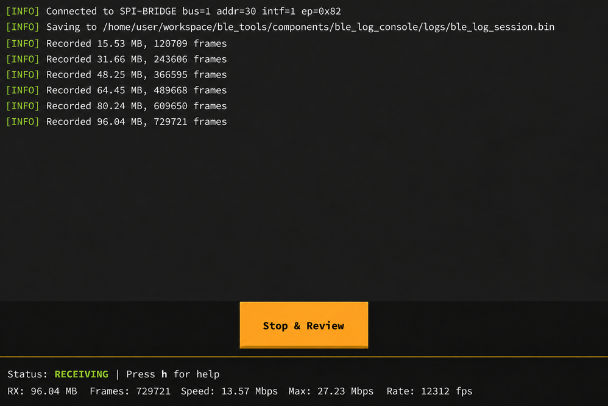

===================================
BLE 日志调试工具 (BLE Log Console)
===================================

:link_to_translation:`en:[English]`

BLE Log Console 是乐鑫提供的电脑端工具，可通过 UART（仅限支持 UHCI 的芯片）或 SPI Bridge 实时接收、显示设备内部的 BLE 日志，并将原始数据保存为 ``.bin`` 文件。BLE 功能异常、常规控制台日志不足以定位问题，或乐鑫技术支持要求提供调试日志时，可使用该工具采集日志。

采集前，先在目标设备固件中启用 BLE Log，并按下文选择传输方式。完成固件编译、烧录和硬件接线后，再启动 BLE Log Console 接收日志。

工具下载
========

请从 `BLE Log Console 发布页面 <https://github.com/espressif/esp-ble-tools/releases/tag/ble_log_console_stable>`__ 下载最新稳定版本。

.. only:: SOC_UHCI_SUPPORTED

    使用 UART 采集日志
    ==================

    UART 模式通过串口直接采集 BLE Log，无需额外的 Bridge 设备。

    固件配置
    --------

    在工程配置中启用带宽优化日志模式，并选择 UART DMA 作为日志传输方式。主要配置项如下：

    .. code-block:: none

        CONFIG_BT_LOG_CRITICAL_ONLY=y
        CONFIG_BLE_LOG_PRPH_UART_DMA=y
        CONFIG_BLE_LOG_PRPH_UART_DMA_PORT=0
        CONFIG_BLE_LOG_PRPH_UART_DMA_BAUD_RATE=3000000
        CONFIG_BLE_LOG_PRPH_UART_DMA_TX_IO_NUM=<GPIO>

    ``CONFIG_BT_LOG_CRITICAL_ONLY`` 会同时启用 BLE Log，并仅采集关键日志以减少传输带宽。UART 端口和 TX GPIO 应与板卡的实际连接一致。使用外接转串口设备时，将 UART TX 连接至其 RX，并连接两个设备的 GND。

    .. note::

        BLE Log Console 中设置的波特率必须与 ``CONFIG_BLE_LOG_PRPH_UART_DMA_BAUD_RATE`` 保持一致。仅用于打印普通日志的 UART 可以复用；如果该 UART 还承载业务通信，请选择其他可用 UART。

使用 SPI Bridge 采集日志
========================

.. important::

    SPI Bridge 模式需要额外准备一台独立的 Bridge 设备。目前将运行特定固件的 ESP32-P4 开发板作为 Bridge。Bridge 设备不能与产生 BLE Log 的目标设备为同一设备。

SPI Bridge 将目标设备输出的 SPI 日志转发至电脑，适合日志流量较大的场景。

连接关系如下：

.. code-block:: text

    目标 ESP 设备 -> SPI Bridge -> 电脑

固件配置
--------

在产生 BLE Log 的目标设备中启用 BLE Log，并选择 SPI Master DMA 传输方式：

.. code-block:: none

    CONFIG_BLE_LOG_ENABLED=y
    CONFIG_BLE_LOG_PRPH_SPI_MASTER_DMA=y
    CONFIG_BLE_LOG_PRPH_SPI_MASTER_DMA_MOSI_IO_NUM=<GPIO>
    CONFIG_BLE_LOG_PRPH_SPI_MASTER_DMA_SCLK_IO_NUM=<GPIO>
    CONFIG_BLE_LOG_PRPH_SPI_MASTER_DMA_CS_IO_NUM=<GPIO>

按照实际 GPIO 配置，将目标设备的 MOSI、SCLK 和 CS 分别连接至 SPI Bridge 对应引脚，并确保两个设备共地。有关 SPI Bridge 固件获取、烧录方法和具体引脚连接，请参阅 `BLE Log Console 中文用户指南 <https://github.com/espressif/esp-ble-tools/blob/main/components/ble_log_console/docs/Console-User-Guide-CN.md>`__。

启动日志采集
============

完成固件配置、烧录和硬件连接后：

#. 启动 BLE Log Console。
#. 选择上文介绍的传输模式及相应端口。

   .. only:: SOC_UHCI_SUPPORTED

       使用 UART 模式时，连接前请关闭占用该端口的串口监视器，并选择与固件配置一致的波特率。

#. 设置日志保存目录，然后连接设备。

连接成功后，工具会实时显示解析出的 BLE Log，并将原始日志保存为 ``.bin`` 文件。如果界面中的接收数据量和帧数持续增加，且传输速度不为零，通常表示日志采集正常。结束录制时，点击 ``Stop & Review`` 或按 ``q`` / ``Ctrl+C``。工具写完缓存数据后会显示录制质量报告。

   BLE Log Console 录制界面

更多帮助
========

有关支持的操作系统、界面与命令行操作、录制文件和问题排查，请参阅 `BLE Log Console 中文用户指南 <https://github.com/espressif/esp-ble-tools/blob/main/components/ble_log_console/docs/Console-User-Guide-CN.md>`__。

如果本页配置示例不适用于现有工程，或无法确定传输方式及接线，请参阅 `BLE Log 配置指南 <https://github.com/espressif/esp-ble-tools/blob/main/components/ble_log_console/docs/Config-Guide-CN.md>`__。如仍需协助，请联系乐鑫技术支持，并提供目标芯片、ESP-IDF 版本和相关配置。
