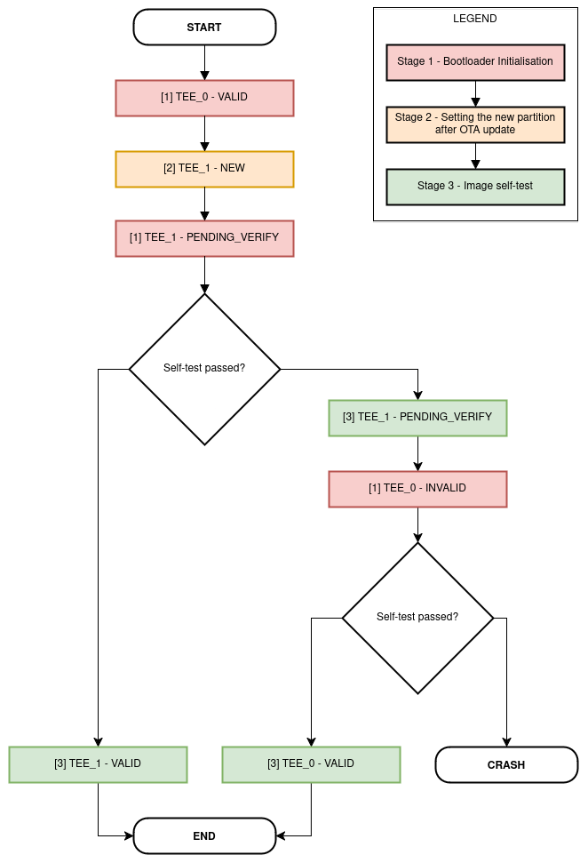

TEE 空中升级 (OTA)
==================

:link_to_translation:`en:[English]`

概述
----

OTA 更新机制允许设备在正常固件运行期间，根据接收到的数据（例如通过 Wi-Fi 或蓝牙）更新自身。应用程序镜像的 OTA 更新在 :doc:`空中升级 (OTA) <../../api-reference/system/ota>` 中已有详细说明，本节专门介绍如何安全管理 TEE 镜像的 OTA 更新。

TEE OTA 要求在设备分区表中至少配置两个 TEE OTA 应用程序分区槽（即 ``tee_0`` 和 ``tee_1``）以及一个 TEE OTA 数据分区（类型为 ``data``，子类型为 ``tee_ota``）。

    .. figure:: ../../../_static/esp_tee/esp_tee_ota_flash_partitions.png
        :align: center
        :scale: 75%
        :alt: ESP TEE OTA flash 分区
        :figclass: align-center

        支持 TEE 与应用程序 OTA 的 flash 分区布局示例

.. _tee-ota-data-partition:

TEE OTA 数据分区
^^^^^^^^^^^^^^^^

任何使用 OTA 功能的项目，其分区表都必须包含 TEE 镜像的 OTA 数据分区（类型为 ``data``，子类型为 ``tee_ota``）。请注意，TEE 应用程序拥有自己的 OTA 数据分区，与 REE 应用程序的 OTA 数据分区相互独立。

出厂启动设置下，TEE OTA 数据分区中应没有数据（所有字节均擦除为 0xFF）。此时，二级引导加载程序会启动第一个可用的 TEE OTA 槽（通常是 ``tee_0``）。第一次 OTA 更新后，TEE OTA 数据分区会被更新，以指定下次应启动哪个 OTA 应用槽分区。

TEE OTA 数据分区的大小为两个 flash 扇区（0x2000 字节），以防止写入过程中断电引发问题。各扇区独立擦除并写入相同的数据；如果两者不一致，则使用 CRC 有效的扇区，并将其复制覆盖另一个扇区。

    .. figure:: ../../../_static/esp_tee/tee_ota_data_entry.png
        :align: center
        :scale: 80%
        :alt: ESP TEE OTA 数据条目
        :figclass: align-center

        ESP-TEE：OTA 数据分区条目

OTA 流程：启动流程与镜像回滚
----------------------------

#. 新的 TEE 应用程序已通过相应接口（Wi-Fi、蓝牙、以太网等）成功下载。REE 应用程序负责下载 TEE OTA 更新。由于它没有直接写入 TEE flash 区域的权限，它会发起相应的服务调用，将新固件写入 flash。
#. 新固件被写入非活动 TEE 分区，并被设为可启动分区，状态为 ``NEW``。这表示该应用程序是新的，应在首次启动期间受到监控。随后由 TEE 自身重启系统，即 :cpp:func:`esp_tee_ota_end` 在成功时不会返回。
#. 引导加载程序会验证 ``tee_otadata`` 分区中第一个扇区的魔数和 CRC。如果无效，则使用第二个扇区。
#. 如果应用程序状态为 ``PENDING_VERIFY``，它将被改写为 ``INVALID``。引导加载程序不会启动任何标记为 ``INVALID`` 的镜像。
#. 如果应用程序状态为 ``NEW``，它将被改写为 ``PENDING_VERIFY``。这表示需要确认该应用程序可以正常运行。如果尚未确认就发生重启，状态将被改写为 ``INVALID``，该应用程序将无法再启动，即回滚到先前可正常工作的应用程序。
#. 新的 TEE 应用程序开始执行，但需要通过自测来确认其可操作性。到达非安全应用程序入口点时，即认为回滚自测成功。随后将该应用程序标记为有效（状态为 ``VALID``）。如果设备没有进一步更新，之后每次重启都会启动该程序。
#. 如果 TEE 镜像存在问题，设备因此未能到达非安全应用程序入口点，则自测失败。设备将此次失败视为严重异常并重启。

.. note::

    由 TEE 触发的复位（TEE OTA 更新成功后，或 TEE/REE 发生 panic 时）也会复位 RTC 域。

.. note::

    - 任何通过串口烧录的分区都会在首次启动时自动标记为有效。
    - 如果两个 ``tee_otadata`` 扇区都有效，但内容不一致，引导加载程序应在将控制权交给 TEE 之前使它们保持一致。
    - 如果启用了 :ref:`安全启动 <secure_boot-guide>`，引导加载程序将验证 TEE 和非安全应用程序。

    TEE OTA 流程

.. _tee-anti-rollback:

防回滚
------

防回滚可以防止启动安全版本低于芯片 eFuse 中所记录版本的 TEE 镜像。它独立于 :ref:`应用程序防回滚 <anti-rollback>` 功能：TEE 和应用程序各自维护独立的安全版本和独立的 eFuse 计数器，因此 TEE 可以提高自己的回滚下限，而无需配合应用程序版本一起发布。

启用 :menuitem:`CONFIG_SECURE_TEE_ANTI_ROLLBACK`，并使用 :menuitem:`CONFIG_SECURE_TEE_SECURE_VERSION` 设置 TEE 镜像的安全版本。该版本存储在 TEE 镜像的 ``esp_app_desc`` 结构体中，纳入镜像哈希的计算范围；如果启用了安全启动，也受安全启动签名保护。它与 :ref:`tee-versioning` 中所述的 TEE 固件版本字符串是不同的概念。

TEE 安全版本存储在 ``SECURE_VERSION`` eFuse 字段的最高 3 位中，以已置位的位数表示。因此，它最多可以增加 3 次，应用程序安全版本可用的位数相应减少 3 位（见 :menuitem:`CONFIG_BOOTLOADER_APP_SEC_VER_SIZE_EFUSE_FIELD`），无需修改 eFuse 表。

安全版本在以下三个环节强制执行：

#. **启动**：二级引导加载程序在加载 TEE 分区之前，将其安全版本与 eFuse 计数器进行比较。安全版本更低的新镜像（``NEW`` 状态）不会被选中进行试启动，而是启动先前的镜像；如果当前已激活镜像的版本更低，引导加载程序会记录错误并复位设备。
#. **TEE OTA**：:cpp:func:`esp_tee_ota_end` 会拒绝安全版本低于 eFuse 计数器或正在运行的 TEE 镜像的新 TEE 镜像，返回 ``ESP_ERR_INVALID_VERSION``，并擦除非活动 TEE 分区。
#. **确认**：正在运行的 TEE 镜像被确认为有效后（见上文的启动流程），TEE 会把 eFuse 计数器更新为自己的安全版本。与应用程序一样，计数器只在成功启动之后才会提高，因此失败的更新不会抬高这一下限。如果 eFuse 写入失败（例如因为 ``SECURE_VERSION`` 字段已被写保护），TEE 会记录错误并继续运行；每次启动都会重试该写入，在此期间，针对正在运行镜像的 TEE OTA 检查可以防止降级。

应用示例
--------

:example:`tee_secure_ota <security/tee/tee_secure_ota>` 示例演示如何通过 HTTP/S 对 TEE 执行空中升级。

API 参考
--------

.. note::

    要在项目中使用 TEE OTA API，请确保组件管理器清单文件 `idf_component.yml <https://docs.espressif.com/projects/idf-component-manager/en/latest/reference/manifest_file.html>`_ 将 :component:`tee_ota_ops <esp_tee/subproject/components/tee_ota_ops>` 组件列为本地依赖。请参考 :example:`tee_secure_ota <security/tee/tee_secure_ota>` 示例。

.. include-build-file:: inc/esp_tee_ota_ops.inc
