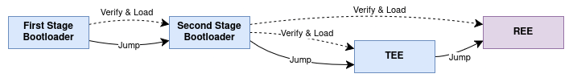

ESP-TEE：用户指南
=================

:link_to_translation:`en:[English]`

ESP-TEE（乐鑫可信执行环境）是构建在专用硬件之上的安全框架，确保只有经过授权的参与方或应用程序才能访问受保护的信息或服务。
启用后，ESP-TEE 与基于 FreeRTOS 的 ESP-IDF 应用程序并行运行。此时，执行环境分为以下两部分：

- **TEE**：受保护的可信执行环境，由 ESP-TEE 管理。

- **REE**：不受保护的富执行环境，ESP-IDF 用户应用程序在此运行。

ESP-TEE 的一个用例是将加密密钥安全地存储在 TEE 中，用于与外部实体进行挑战-响应协议认证。ESP-TEE 还可以通过安全通信来保护数据。

ESP-TEE 提供以下几项关键安全服务，包括：

- :doc:`安全存储 <tee-sec-storage>`

  ESP-TEE 提供安全存储，确保敏感数据存放在经过加密的外部 flash 分区中，REE 完全无法访问。它还支持安全的密钥管理，以及用于签名和加密的操作。

- :doc:`证明 <tee-attestation>`

  证明机制使设备能够通过经过密码学保护的令牌，声明自身的身份和安全状态。ESP-TEE 以预定义的 JSON 格式生成该令牌，并使用 ECDSA 方案进行签名。

- :doc:`空中升级 (OTA) <tee-ota>`

  ESP-TEE 支持安全的 TEE OTA 更新机制，允许设备使用正常运行期间接收的数据（例如通过 Wi-Fi 或蓝牙）更新 TEE 固件。该机制还支持更新回滚。

更多信息请参阅 :ref:`安全服务 <tee-secure-services>` 一节。

保护范围
--------

:doc:`安全启动 <../secure-boot-v2>` 功能确保设备上只能执行经过认证的软件。启用后，构建过程会在生成已签名 REE 镜像的同时生成已签名的 TEE 镜像。两者使用相同的签名方案和密钥。

安全启动为 :doc:`应用程序启动流程 <../../api-guides/startup>` 中涉及的所有可变软件实体（即二级引导加载程序、TEE 和 REE 应用程序）建立可靠的信任链。启动时和 OTA 更新时都会进行签名验证。安全启动保障启动时的安全，ESP-TEE 则通过保护 TEE 内的安全资产来提供运行时安全。

此外，证明服务会在收到请求时验证当前选用的全部软件的签名和固件哈希，从而持续防范未经授权的修改。

:doc:`flash 加密 <../flash-encryption>` 功能会加密 {IDF_TARGET_NAME} 片外 flash 存储器中的内容，防止通过物理读出恢复其中的数据。flash 加密密钥安全地存储在硬件中，TEE 和 REE 均无法访问。

    ESP-TEE：启用安全启动时 {IDF_TARGET_NAME} 的启动流程

.. important::

    强烈建议在所有量产设备上同时启用安全启动、flash 加密和 ESP-TEE。

架构：简要概述
--------------

ESP-TEE 提供以信任根 (RoT) 为中心的安全执行环境。信任根是一组系统或设备在安全性上所依赖的隐式受信任功能。

**不可变信任根** 由以下组件组成：

- 一级引导加载程序 (BootROM)
- 隔离硬件
- 密码学硬件 (AES, SHA)
- eFuse

**可更新信任根** 包括二级引导加载程序和 TEE 固件。TEE 固件负责安全配置、初始化、中断处理、异常管理，并提供密码学操作所需的安全服务，以及安全存储和证明等功能。

各组件和架构的更多详情，请参阅 :ref:`详细架构 <tee-detailed-architecture>` 一节。

.. _tee-memory-allocation:

内存分配
--------

ESP-TEE 将内存划分为 TEE 和 REE 的独立区域，把一部分内部 SRAM 和外部 flash 分配给 TEE。这种隔离保护 TEE 内的敏感数据和操作，防止 REE 未经授权的访问。

.. _tee-internal-memory:

内部存储器 (SRAM)
^^^^^^^^^^^^^^^^^

依据 :ref:`esp-tee-trusted-execution-environment-` 菜单中 :ref:`内存配置 <esp-tee-trusted-execution-environment--enable-the-esp-tee-framework-memory-configuration>` 一节下的 Kconfig 选项，将内部存储器分配给 TEE。其余内存全部分配给 REE。

.. warning::

  修改上述值需自行承担风险，这可能导致构建失败或运行时故障。

TEE 和 REE 各自拥有独立的堆分配器，分别在分配给对应应用程序的内存中工作。

.. _tee-external-memory:

外部存储器 (Flash)
^^^^^^^^^^^^^^^^^^

外部 flash 中的指定分区保留给 TEE，用于支持代码 XIP（就地执行）、安全存储和 OTA 数据等功能。分区表必须至少包含一个 TEE 应用程序分区槽（类型为 ``app``，子类型为 ``tee_0``），最小大小为 192 KB。

分区表示例如下： ::

  # ESP-IDF Partition Table
  # Name,         Type, SubType,     Offset,   Size, Flags
  tee_0,          app,  tee_0,       0x10000,  192K,
  secure_storage, data, nvs,         0x40000,  64K,
  factory,        app,  factory,     0x50000,  1M,
  nvs,            data, nvs,         0x150000, 24K,
  phy_init,       data, phy,         0x156000, 4K,

.. important::

  最后一个 TEE 相关分区之后的分区必须按所配置的 MMU 页大小对齐。验证用户应用程序 (REE) 镜像时需要这一对齐，以避免安全启动验证失败。

.. note::

  关于 ESP-TEE 下 flash 存储器保护的默认策略和范围，请参阅进阶指南中的 :ref:`Flash 保护 - 虚拟访问与物理访问 <tee-flash-prot-scope>` 一节。

.. _tee-secure-services:

安全服务
--------

TEE 向 REE 开放的所有功能都实现为安全服务。REE 可以通过接口 API :cpp:func:`esp_tee_service_call` 和 :cpp:func:`esp_tee_service_call_with_noniram_intr_disabled` 调用这些安全服务。安全服务可以被 TEE 或 REE 中断抢占。

.. note::

  由于 TEE 目前不支持多任务，安全服务调用会串行执行，后续调用会一直等待，直到当前服务完成。

对于 {IDF_TARGET_NAME}，安全服务列表见 :component_file:`表格<esp_tee/scripts/{IDF_TARGET_PATH_NAME}/sec_srv_tbl_default.yml>`。安全服务分为以下几类。

- **核心安全服务**：TEE 固件内置的服务，向 REE 提供常规功能，例如中断配置和 eFuse 访问。

- **可选安全服务**：可配置的服务，用于扩展 TEE 的能力，并可按需启用或禁用，例如证明。

- **自定义安全服务**：用户应用程序所需的自定义安全服务。更多详情请参阅 :ref:`添加自定义安全服务 <custom-secure-services>` 一节和 :example:`tee_basic <security/tee/tee_basic>` 示例。

使用方法
--------

#. **启用 ESP-TEE**：在 :ref:`项目配置 <project-configuration-guide>` 菜单中，进入 :ref:`esp-tee-trusted-execution-environment-`，并设置选项 :menuitem:`CONFIG_SECURE_ENABLE_TEE`。

#. **配置 TEE 日志**：

   - 设置 :menuitem:`CONFIG_SECURE_TEE_DEBUG_MODE`，以启用 TEE 日志。

   - 设置 :menuitem:`CONFIG_SECURE_TEE_LOG_LEVEL`，以选择日志详细级别。

#. **配置 TEE 内存区域**：

   - 设置 :menuitem:`CONFIG_SECURE_TEE_IRAM_SIZE`，以配置 TEE IRAM 大小。

   - 设置 :menuitem:`CONFIG_SECURE_TEE_DRAM_SIZE`，以配置 TEE DRAM 大小。

   - 设置 :menuitem:`CONFIG_SECURE_TEE_STACK_SIZE` 和 :menuitem:`CONFIG_SECURE_TEE_INTR_STACK_SIZE`，从保留的 DRAM 中配置 TEE 任务栈和中断栈。

#. **配置分区表**：

   - 在 :menuitem:`CONFIG_PARTITION_TABLE_TYPE` 下选择一个简单的预定义分区表：*Single factory app, no OTA, TEE* 或 *Two OTA definitions, TEE*。

   - 也可以选择 *Custom partition table CSV* 选项，并按照 :ref:`tee-external-memory` 一节中的说明定义自己的布局。

.. _tee-versioning:

固件版本
--------

TEE 固件在其应用程序描述符 (:cpp:type:`esp_app_desc_t`) 的 ``version`` 字段中携带独立于 ESP-IDF 版本的自身版本。该版本会打印在 TEE 启动日志中，并通过 :doc:`证明 <tee-attestation>` 令牌上报。

版本定义在 :component_file:`esp_tee/version.cmake` 和 :component_file:`esp_tee/include/esp_tee_version.h` 中，格式为 ``<major>.<minor>.<patch>~v<IDF major>.<IDF minor>.<IDF patch>`` （例如 ``1.2.0~v6.2.0``），遵循 `语义化版本 <https://semver.org/>`_：TEE 版本标识 TEE 源码，后缀标识构建所用的 ESP-IDF 版本。

.. list-table::
   :header-rows: 1
   :widths: 30 70

   * - TEE 版本
     - ESP-IDF 版本系列
   * - ``1.0.x``
     - v5.5
   * - ``1.1.x``
     - v6.0、v6.1
   * - ``1.2.x``
     - v6.2

.. note::

    TEE 固件版本与 :ref:`TEE 防回滚 <tee-anti-rollback>` 所使用的 TEE *安全版本* 是不同的概念。

可复现构建与代码哈希
^^^^^^^^^^^^^^^^^^^^

TEE 二进制文件的构建是可复现的，与 REE 应用程序配置无关：相同的 ESP-IDF 版本、目标和 TEE 配置始终生成逐字节相同的 ``esp_tee.bin``。

会改变已编译 TEE 代码的选项（例如编译器优化级别、断言级别、日志详细级别、安全启动）属于 TEE 配置，因此会改变镜像及其代码哈希。

镜像中仍嵌入打包元数据（flash 模式/频率/容量、芯片版本上下限、版本字符串、ESP-IDF 版本和 ELF 摘要），因此即使已编译代码不变，这些元数据变化也会改变整个镜像文件的 SHA-256。

**代码哈希** 不包含镜像头、应用程序描述符、校验和以及附加摘要，只覆盖镜像段，因此标识的是已编译的代码。可以使用 :component_file:`esp_tee/scripts/esp_tee_code_hash/esp_tee_code_hash.py` 从已构建的镜像计算代码哈希，设备也会在证明令牌中上报该值（见 :doc:`tee-attestation`）。

应用示例
--------

:example:`security/tee` 目录中提供了多个示例，展示各项 ESP-TEE 安全服务。更多详细信息请参阅每个具体示例中的 ``README.md`` 文件。

API 参考
--------

.. include-build-file:: inc/esp_tee.inc
.. include-build-file:: inc/esp_tee_version.inc
