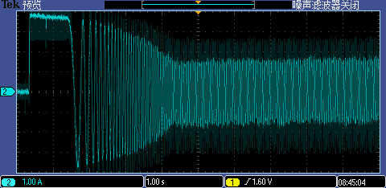
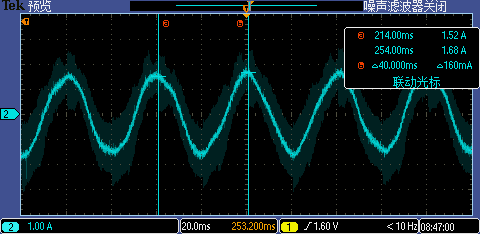
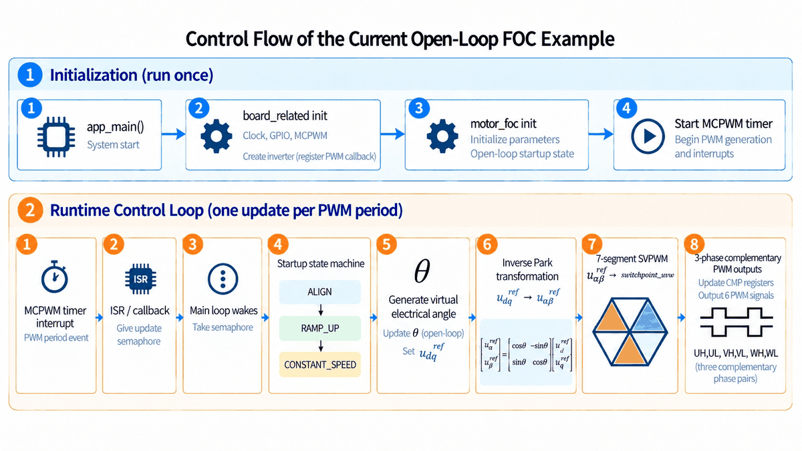
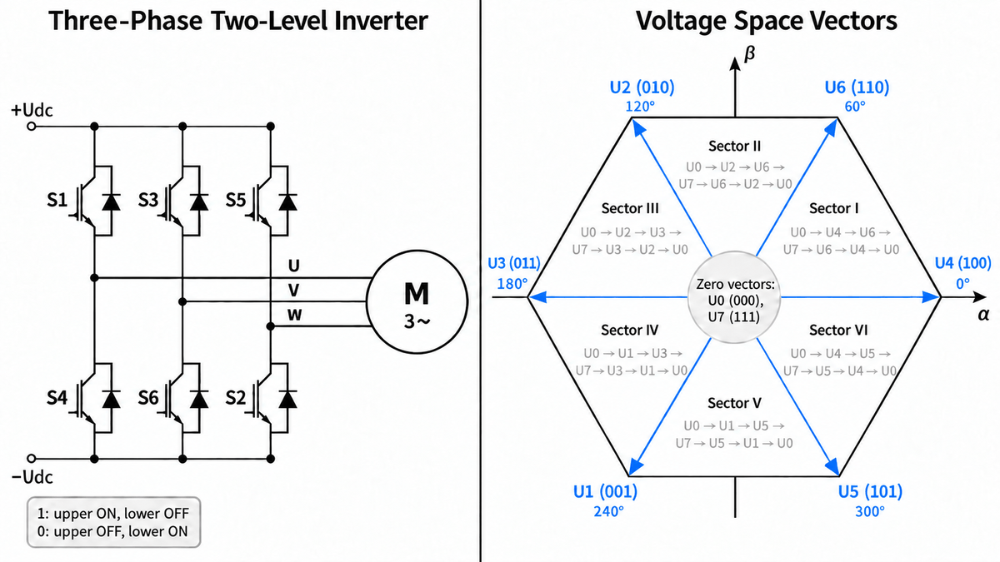

| Supported Targets | ESP32 | ESP32-C5 | ESP32-C6 | ESP32-H2 | ESP32-H21 | ESP32-H4 | ESP32-P4 | ESP32-S3 | ESP32-S31 |
| ----------------- | ----- | -------- | -------- | -------- | --------- | -------- | -------- | -------- | --------- |

# MCPWM FOC Open-Loop Control Example

(For general overview of examples and their usage, see the [README](../../../README.md) file in the upper level `examples` directory.)

> [!NOTE]
> After you click any link to [ESP-IDF Programming Guide](https://docs.espressif.com/projects/esp-idf/en/latest/index.html), go to the top of the sidebar, then make sure you have the appropriate **Espressif chip** (target) and **ESP-IDF version** selected in the dropdown menus.

This example demonstrates open-loop field-oriented control (FOC) of a three-phase PMSM/BLDC motor using the [MCPWM peripheral](https://docs.espressif.com/projects/esp-idf/en/latest/api-reference/peripherals/mcpwm.html).

The current revision implements the **open-loop startup and modulation foundation** for a future dual-loop FOC controller. It currently provides:

- Rotor alignment at a fixed virtual electrical angle
- Linear open-loop electrical-frequency ramp-up
- Constant-speed open-loop operation
- Q15 fixed-point control calculations using `espressif/iqmath`
- Inverse Park transformation using `espressif/clarke_park`
- Symmetric seven-segment SVPWM
- Center-aligned three-phase MCPWM outputs
- Complementary high-side/low-side PWM generation with dead time

The following features are **not implemented yet**:

- Rotor-position feedback
- Phase-current sampling
- Closed-loop for d/q-axis current control
- Closed-loop for speed control
- Sensorless rotor-state estimation

## Usage

The subsections below give only the necessary information. For full steps to configure ESP-IDF and build and run projects, see [ESP-IDF Getting Started](https://docs.espressif.com/projects/esp-idf/en/latest/get-started/index.html#get-started).

### Hardware Required

- An ESP development board with MCPWM support
- Three-phase inverter board and PMSM/BLDC motor
- A current-limited DC power supply
- Oscilloscope or logic analyzer for initial PWM verification

The default configuration is intended for an **ESP32-P4 Function EV Board** connected to a **DengFOC V3 Plus** inverter.

### Set Chip Target

First of all, your target must be supported by both:

- **By your ESP-IDF version**: For the full list of supported targets, run:
  ```
  idf.py --list-targets
  ```
- **By this example**: For the full list of supported targets,  refer to the supported targets table at the top of this README.

After you make sure that your target is supported, go to your example project directory and [set the chip target](https://docs.espressif.com/projects/esp-idf/en/latest/api-guides/tools/idf-py.html#select-the-target-chip-set-target):

```bash
idf.py set-target <target>
```

For example, to set ESP32-P4 as the chip target, run:

```bash
idf.py set-target esp32p4
```

### Configure the Project

To configure the inverter hardware and FOC control parameters, run:

```bash
idf.py menuconfig
```

The options are available under:

```text
Example Configuration
├── Inverter Configuration
└── FOC Control Configuration
```

The default values are:

| Parameter | Default |
| --- | ---: |
| FOC control frequency / Inverter modulation frequency | 10 kHz |
| Rotor-alignment duration | 1000 ms |
| Open-loop target electrical frequency | 25 Hz |
| Nominal ramp-up divisions | 20000 |
| Open-loop d-axis voltage reference | 40% of $`U_{\mathrm{dc}} / \sqrt{3}`$ |
| MCPWM timer resolution | 10 MHz |
| Dead time | 5 timer ticks |

The ramp-division setting is nominal. Because the electrical-angle increment is represented using fixed-point arithmetic, the actual number of control cycles required to reach the target frequency may exceed this value.

### Build and Flash

Execute the following command to build the project, flash it to your development board, and run the monitor tool to view the serial output:

```bash
idf.py build flash monitor
```

This command can be reduced to `idf.py flash monitor`.

If the above command fails, check the log on the serial monitor which usually provides information on the possible cause of the issue.

To exit the serial monitor, use `Ctrl` + `]`.

### Verify PWM Outputs

Before connecting motor power, verify the PWM outputs using an oscilloscope or logic analyzer.

Recommended checks include:

- The PWM frequency matches the configured inverter modulation frequency.
- U/V/W high-side pulses are center aligned.
- Complementary outputs contain the configured dead time.
- The modulation pattern repeats at the configured electrical frequency.

## Example Output

If you see the following console output, your example should be running correctly:

```text
I (...) mcpwm_foc_open_loop: MCPWM motor FOC example started
I (...) mcpwm_foc_open_loop: Inverter PWM started
I (...) mcpwm_foc_open_loop: Gate driver enabled
```

The following measured phase-current waveform captures the complete open-loop startup process.

During **ALIGN**, the fixed stator-voltage vector establishes the rotor-alignment current.

During **RAMP_UP**, the electrical frequency increases progressively, which is visible as the gradually shortening current period.

After the target electrical frequency is reached, the waveform enters **CONSTANT_SPEED** operation.



The expanded waveform below shows the phase current during the constant-speed stage.

With the target electrical frequency configured to 25 Hz, the measured current period is approximately 40 ms.



## Example Breakdown

### Control Flow

The current control flow is shown below:



The MCPWM timer runs in up-down count mode, producing center-aligned high-side PWM pulses. By default, the three comparator shadow values are latched synchronously at the timer-empty (TEZ) event, so all phase switch points take effect at the same PWM-cycle boundary.

### Open-Loop Startup

The current startup sequence contains three stages:

1. **ALIGN**
   Hold the virtual electrical angle at 0 degrees and apply a fixed d-axis voltage reference for the configured alignment duration.

2. **RAMP_UP**
   Increase the electrical-angle increment linearly until the configured target electrical frequency is reached.

3. **CONSTANT_SPEED**
   Keep the electrical-angle increment constant and continue rotating the virtual stator-voltage vector at the target electrical frequency.

The configured frequency is an **electrical frequency**. The corresponding ideal mechanical speed is:

```math
n_{\mathrm{mech}} = \frac{60 f_{\mathrm{elec}}}{p}
```

where $`n_{\mathrm{mech}}`$ is the ideal mechanical speed in rpm, $`f_{\mathrm{elec}}`$ is the electrical frequency in Hz, and $`p`$ is the number of motor pole pairs.

### Numerical Representation

The current implementation uses **Q15 fixed-point arithmetic**.

The d/q and alpha-beta voltage references are normalized against:

```math
U_{\mathrm{base}} = \frac{U_{\mathrm{dc}}}{\sqrt{3}}
```

Therefore, a normalized magnitude of `1.0` corresponds to the maximum circular voltage-reference magnitude used by the linear SVPWM region.

Angles are represented as physical angles rather than per-unit angles. The long-lived electrical-angle variable is stored in degrees using Q15. It is converted temporarily to Q15 radians before calling the inverse Park transform.

### Seven-Segment SVPWM

The modulation module implements symmetric seven-segment SVPWM.



For each PWM cycle, the modulation module:

1. Determines the sector from the alpha-beta voltage reference.
2. Calculates the two active-vector dwell times.
3. Handles overmodulation by proportionally scaling the active-vector times when necessary.
4. Calculates the three switching instants in the first half of the center-aligned PWM cycle.
5. Maps the switching instants to U/V/W phase switch points according to the current sector.

The modulation layer returns switch points in timer ticks. The board-specific inverter layer applies them to the MCPWM comparators.

## Troubleshooting

This example implements open-loop control without rotor-position or phase-current feedback. If the motor vibrates, stalls, or draws abnormal current, disconnect the motor power and verify:

- The motor phase sequence
- The configured GPIO assignments
- The power-supply voltage and current limit
- The rotor-alignment duration
- The target electrical frequency
- The ramp-up and voltage-reference settings

If the build reports that the open-loop ramp increment is below the Q15 resolution, reduce the nominal ramp-up divisions or increase the target electrical frequency.

For technical queries, please open an [issue](https://github.com/espressif/esp-idf/issues) on GitHub.

## Reference

- [ESP-IDF: MCPWM](https://docs.espressif.com/projects/esp-idf/en/latest/api-reference/peripherals/mcpwm.html)
- [ESP-IDF Getting Started](https://docs.espressif.com/projects/esp-idf/en/latest/get-started/index.html#get-started)
- [Project Configuration](https://docs.espressif.com/projects/esp-idf/en/latest/api-reference/kconfig.html)
- [Espressif IQMath Component](https://components.espressif.com/components/espressif/iqmath)
- [Espressif Clarke/Park Component](https://components.espressif.com/components/espressif/clarke_park)
